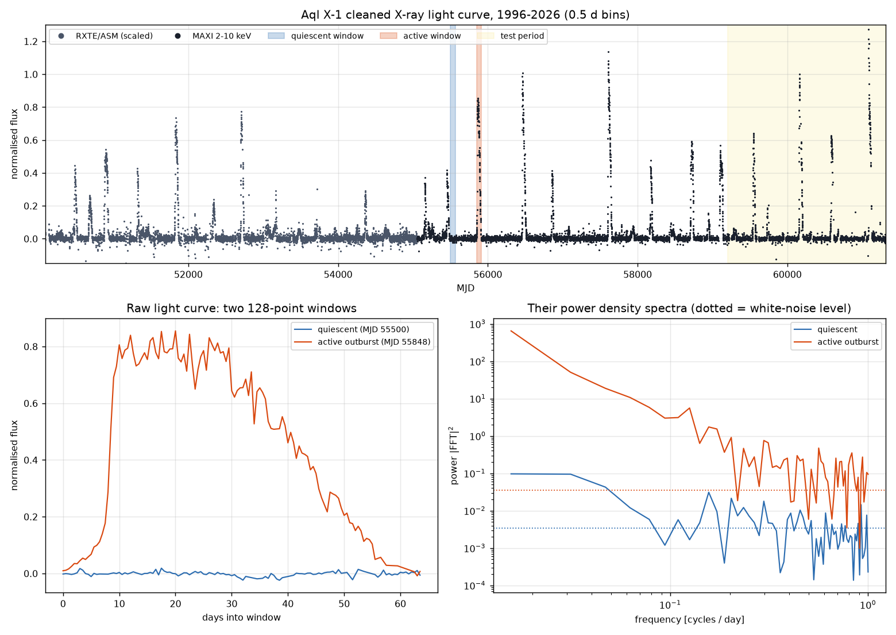
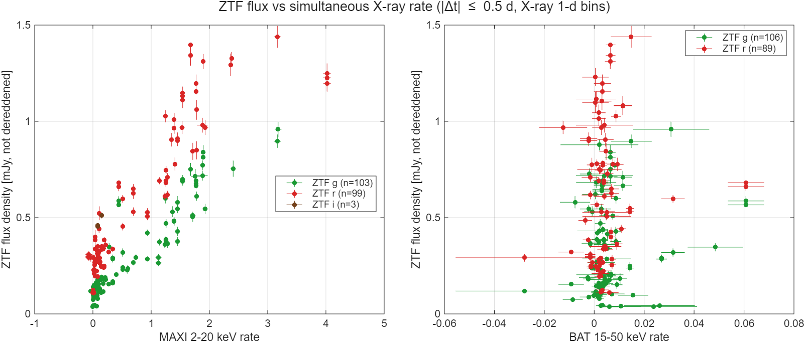

# Aql X-1: X-ray light curves, Fourier features and a JAX/Flax classifier

A side project I did on a whim to test my coding skills outside of aerospace. Aql X-1 is a neutron star in a binary system that flares up in X-rays roughly once a year, and there's about 30 years of free public telescope data on it, so I wanted to see what I could actually do with it.



## What I did

- Downloaded 30 years of X-ray data from three space telescopes (RXTE, MAXI and Swift), cleaned it up and stitched it into one timeline
- Compared the X-ray data against ground-based optical data from ZTF in MATLAB
- In Python, broke the timeline into 64 day chunks, ran a Fourier transform on each one and trained a small neural network (JAX/Flax) to tell when the star was quiet and when it was flaring
- Tested it on 2020-2026 data it never saw during training, and on three other similar star systems

## What I found

It got about 90% right on the unseen data, but a simple brightness check did just as well, so the network wasn't really learning anything clever. The star is just way brighter when it flares, and that's most of what the network picked up on. Trying to predict a flare before it started didn't work at all, which makes sense because when the star is quiet the X-ray data is basically just noise.

I kept both of those in because working out why something doesn't work taught me more than the parts that did. The full write-up with all the numbers is in [docs/technical_notes.md](docs/technical_notes.md).



The optical side matched up well, when the star gets brighter in X-rays it gets brighter in visible light too.

## Running it

Everything runs on CPU. The data isn't in the repo since it's all public, the first script downloads it.

```bash
uv venv ~/venvs/jax --python 3.12
uv pip install --python ~/venvs/jax/bin/python jax flax optax matplotlib pandas astropy
bash run_all.sh                          # main Aql X-1 analysis, about 20 s once the data is downloaded
bash multi_source/run_multi_source.sh    # the other three star systems, about 5 min
```

Both scripts look for Python at `~/venvs/jax/bin/python`. If yours is somewhere else, run them with `PY=/path/to/python bash run_all.sh`.

The MATLAB scripts in `matlab/` expect their data in `matlab/data/`:

- `ZTF AQL-X1 DATA/` with `detections.csv`, `forced_photometry.csv` and `non_detections.csv`, the ALeRCE export for ZTF18accedau
- `maxi 1 orbit Light curve.txt`, the [MAXI 1-orbit light curve](http://maxi.riken.jp/star_data/J1911+005/J1911+005_g_lc_1orb_all.dat)
- `swift-bat 1 orbit Light curve.txt`, the [Swift/BAT 1-orbit light curve](https://swift.gsfc.nasa.gov/results/transients/AqlX-1.orbit.lc.txt)

Disclaimer: I used AI to help write `investigate_aqlx1_maxi.m`, mainly because I needed help getting the data imported.

## What's in here

- `scripts/` the main Python code
- `models/` the trained network weights
- `figures/` plots from the main Aql X-1 analysis
- `reports/` logs, metrics and a check of every step against the real outputs
- `multi_source/` the same model tested on GX 339-4, V404 Cyg and Sco X-1
- `matlab/` the optical vs X-ray comparison
- `docs/technical_notes.md` the full technical write-up

## Data credits

All the data is public. This uses MAXI data provided by RIKEN, JAXA and the MAXI team, Swift/BAT transient monitor results provided by the Swift/BAT team, RXTE/ASM data from NASA's HEASARC, and ZTF data accessed through the ALeRCE broker.

## Licence

MIT, see [LICENSE](LICENSE).
